# 🐾 뽈뽈 (BbolBbol)

> **서울 종로구를 돌아다니며 포인트를 모으는 위치 기반 퀘스트 앱 (프로토타입)**

장소가 곧 퀘스트입니다. 지도에서 가고 싶은 장소의 퀘스트를 받고, 그곳에 실제로 도착해 **도착 인증**을 하면 포인트를 받습니다. 모은 포인트는 통계와 랭킹으로 확인할 수 있습니다.

<p align="center">
  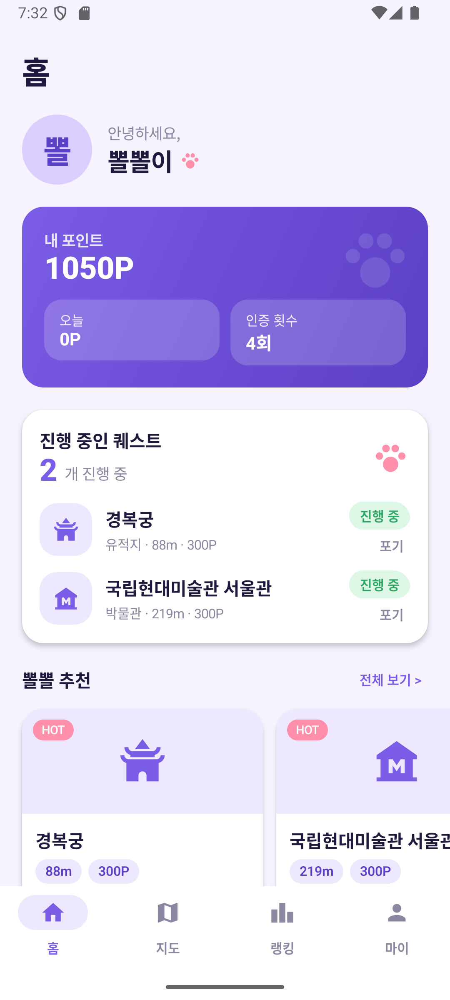
  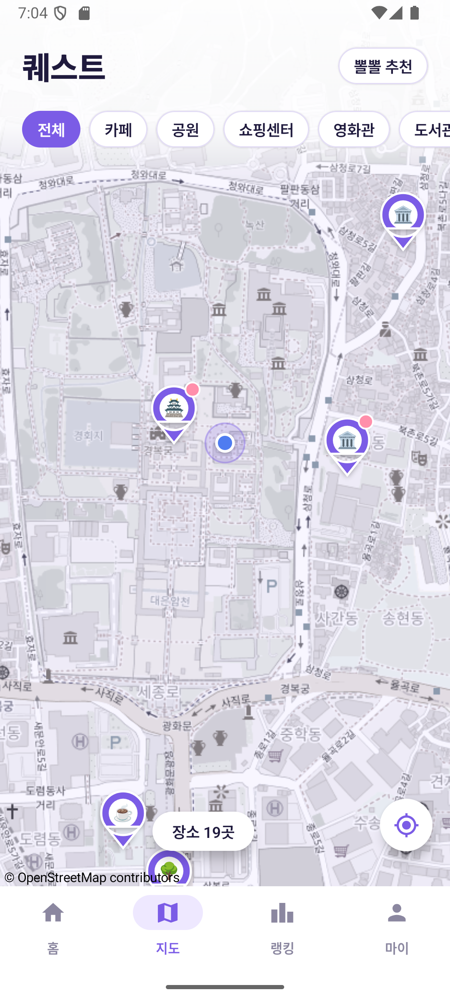
  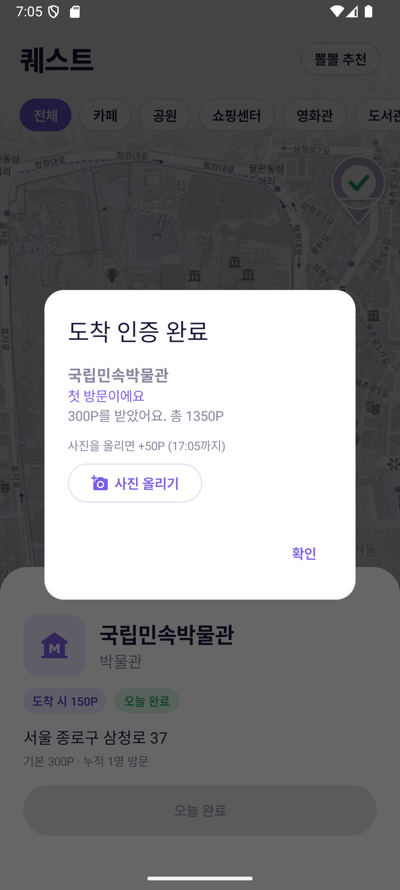
</p>

- 위치 기반 퀘스트 앱: Kotlin + Jetpack Compose (Android)
- 명세 API 28개 구현, 앱 전 화면 구현, 에뮬레이터 E2E 검증 완료
- 시간대는 Asia/Seoul, 한 주는 월요일부터 시작합니다.

---

## 어떻게 동작하나요?

```
 ① 지도에서 장소 선택  →  ② 퀘스트 받기  →  ③ 장소에 도착  →  ④ 도착 인증  →  ⑤ 포인트 적립
        (종로구 33곳)        (홈에 표시)       (반경 안에서)     (위치 검사)     (사진을 올리면 보너스)
```

### 포인트 규칙
| 상황 | 포인트 |
|---|---|
| 처음 가는 장소에 도착 인증 | 장소 기본 점수의 **100%** |
| 이미 간 장소에 다시 도착 인증 | 기본 점수의 **50%** |
| 인증 사진 올리기 (첫 방문만) | **+50P** 보너스 (재방문은 0P) |
| 같은 장소 | **하루에 한 번**만 인증 가능 |

장소마다 기본 점수가 있고(카페·공원 100~150P, 유적지·박물관 300P 등), 장소 점수가 카테고리 점수보다 우선합니다.

---

## 화면 둘러보기

> 에뮬레이터(AVD `Medium_Phone`)에서 실제 서버와 연결해 찍은 화면입니다. 위치는 경복궁으로 고정했습니다.

### 1. 시작하기: 로그인, 회원가입, 온보딩

이메일 가입(이메일 인증 코드, 이메일·닉네임 실시간 중복 확인), 카카오 로그인, 비밀번호 재설정을 지원합니다. 가입 직후에는 연령대, 성별, 관심 카테고리(최대 3개)를 고르는 **온보딩**을 거치며, 온보딩을 마쳐야 도착 인증과 랭킹 참여가 가능합니다.

<p align="center">
  
  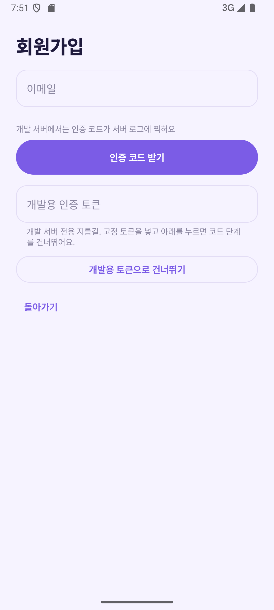
  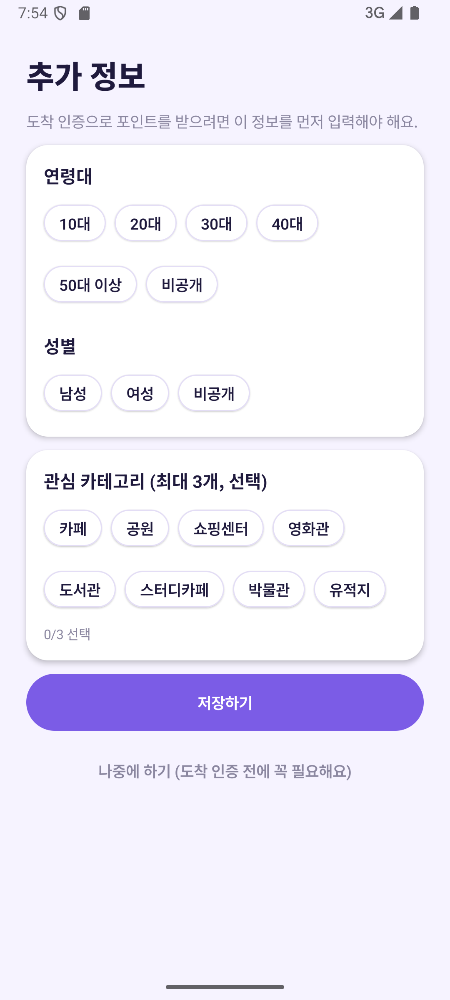
</p>

### 2. 홈: 내 포인트, 진행 중인 퀘스트, 뽈뽈 추천

- **내 포인트 카드**: 누적 포인트, 오늘 얻은 포인트, 인증 횟수
- **진행 중인 퀘스트**: 받아 둔 퀘스트를 거리와 예상 포인트와 함께 보여 주고, 언제든 포기할 수 있습니다.
- **뽈뽈 추천**: 뽈뽈이가 고른 추천 장소(HOT)를 가로로 넘겨 봅니다.

<p align="center">
  
  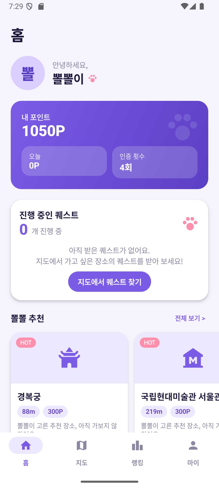
  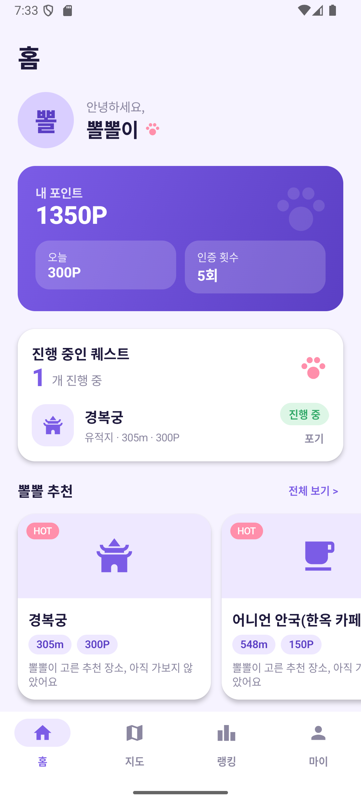
</p>

### 3. 지도: 장소 찾기와 퀘스트 받기

- 종로구 장소를 **카테고리 핀**으로 표시하고, 파란 점은 내 위치입니다. (OpenStreetMap)
- 카테고리 필터(카페, 공원, 쇼핑센터, 영화관, 도서관 등)와 "뽈뽈 추천" 바로가기
- 핀을 누르면 장소 정보(주소, 도착 시 받는 포인트, 오늘 방문 여부)가 뜨고 **퀘스트 받기**를 누를 수 있습니다.
- 핀 모양으로 상태를 구분합니다: 받지 않음, 진행 중, 오늘 완료(✔).
- 위치 권한이 없으면 **둘러보기 모드**로 지도만 볼 수 있습니다. (인증은 불가)

<p align="center">
  
  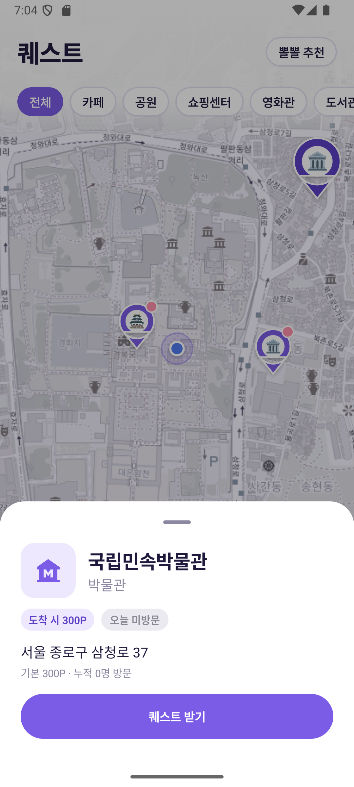
  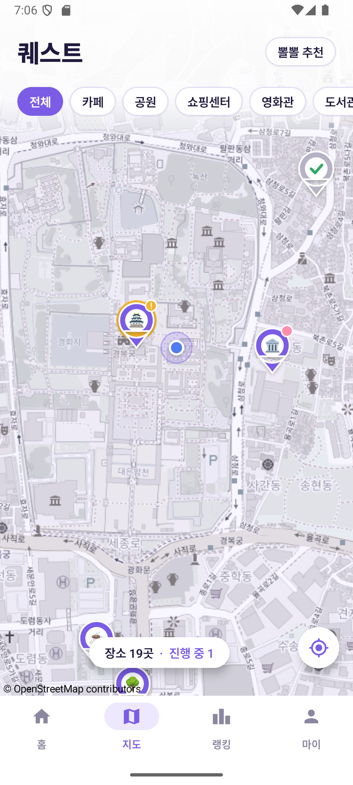
</p>

### 4. 도착 인증과 사진 보너스

장소 반경 안에서 인증하면 포인트가 적립됩니다. 서버가 위치, 정확도, 모의 위치(가짜 GPS) 여부, 하루 1회 제한을 검사합니다. 반경 밖이면 거절되고, 첫 방문이면 **사진을 올려 +50P**를 더 받을 수 있습니다. 사진은 서버에서 위치 정보(EXIF)를 지우고 다시 저장합니다.

<p align="center">
  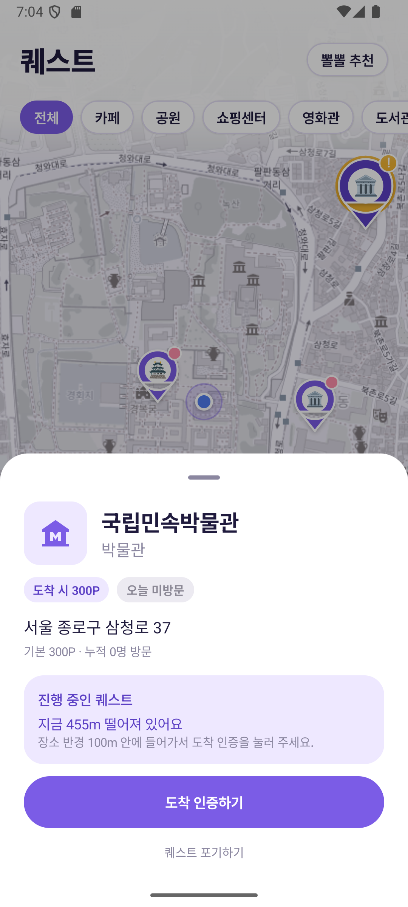
  
  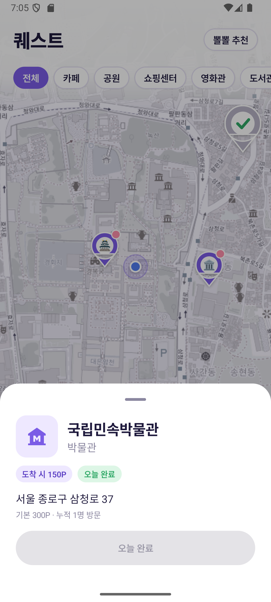
</p>

### 5. 뽈뽈 추천

안 가 본 장소를 먼저, 가까운 순으로 추천합니다. 추천 카드에서 바로 퀘스트로 이어집니다.

<p align="center">
  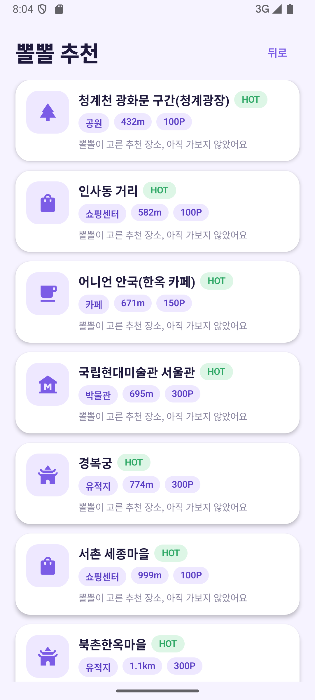
</p>

### 6. 포인트 내역과 활동 일지

적립 내역(도착 인증, 사진 보너스)을 시간순으로 보고, 활동 일지에서는 기간과 카테고리로 걸러 볼 수 있습니다. 목록은 커서 방식으로 이어서 불러옵니다.

<p align="center">
  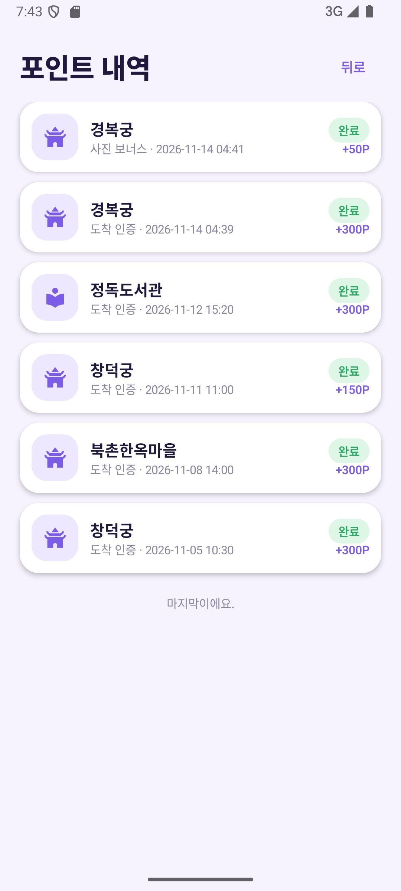
  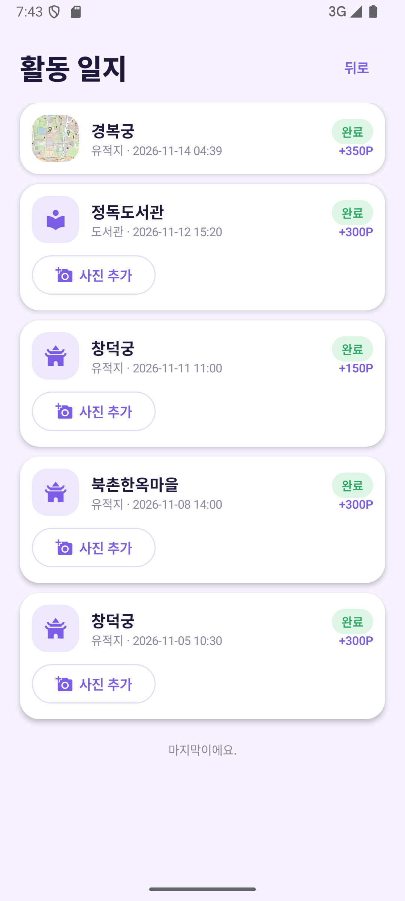
</p>

### 7. 퀘스트 통계

주 / 월 / 년 단위로 인증 횟수, 포인트, 방문 장소 수를 보여 주고, 지난 기간과 비교합니다. 막대 차트로 활동 추이를, 도넛 차트로 카테고리별 비율을 확인합니다.

<p align="center">
  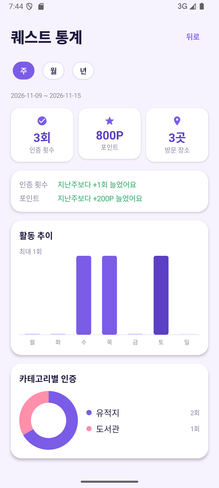
  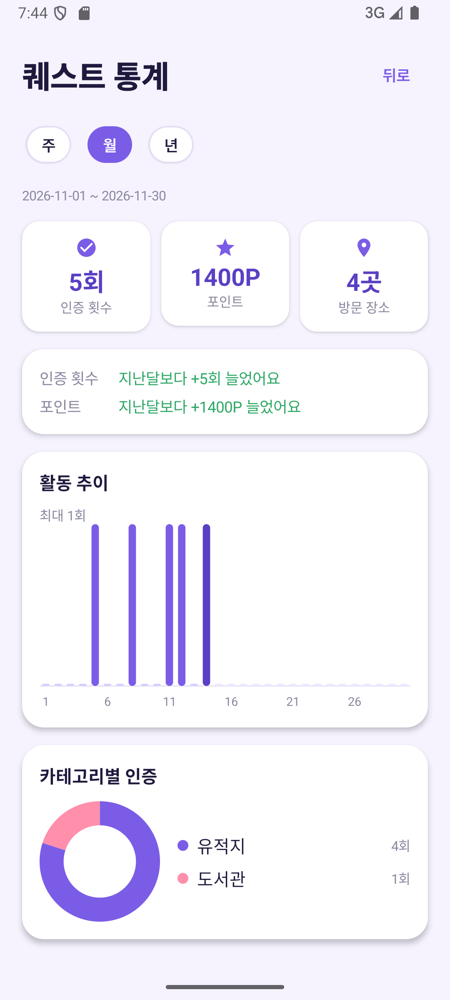
  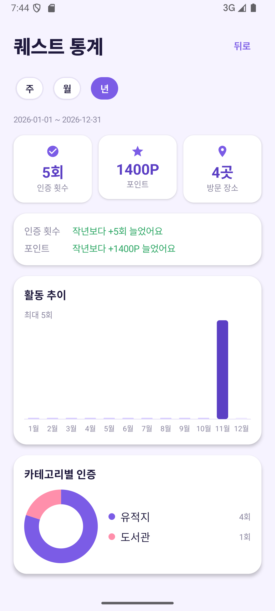
</p>

### 8. 랭킹

**사용자**, **장소**, **연속 참여** 세 가지 랭킹을 오늘 / 이번 주 / 이번 달로 볼 수 있고, 맨 위에 내 순위가 고정됩니다. 온보딩을 마치지 않은 사용자는 랭킹에서 제외됩니다.

<p align="center">
  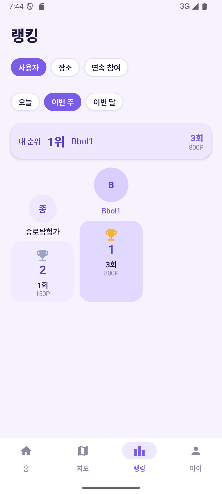
  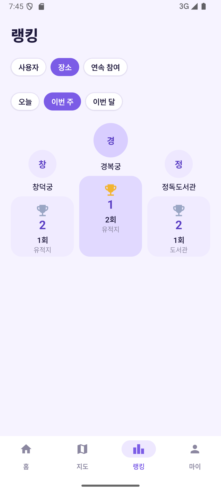
  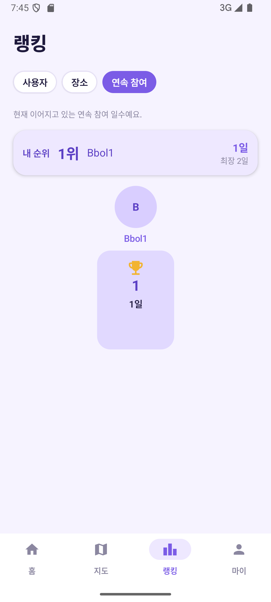
</p>

### 9. 마이

프로필, 총 포인트와 오늘 포인트, 인증 횟수, 닉네임 변경(**30일에 한 번**), 최근 퀘스트 기록, 로그아웃, 회원 탈퇴가 있습니다. 탈퇴하면 닉네임은 "탈퇴한 사용자"로 표시되고 인증 사진과 위치 좌표는 삭제됩니다.

<p align="center">
  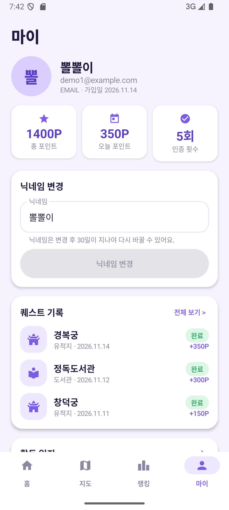
  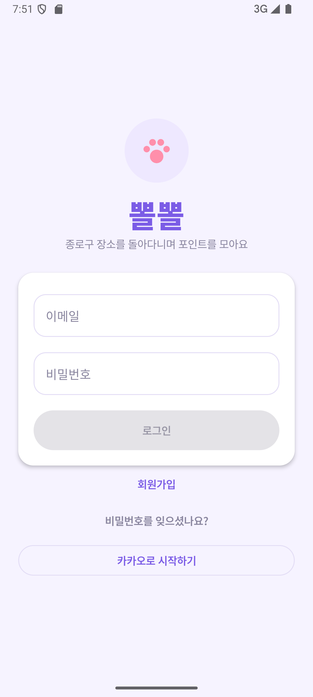
  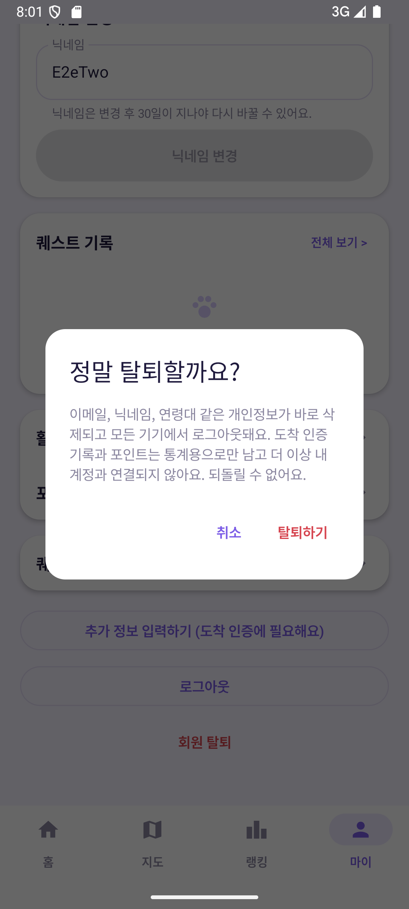
</p>

---

## 주요 기능 한눈에 보기

| 영역 | 기능 |
|---|---|
| 계정 | 이메일 가입(인증 코드), 로그인, 카카오 로그인, 비밀번호 재설정, 토큰 자동 재발급, 로그아웃, 회원 탈퇴 |
| 장소 | 종로구 샘플 장소 33곳, 카테고리 8종, 내 주변 장소(반경·카테고리·거리순), 장소 상세 |
| 퀘스트 | 퀘스트 받기, 포기, 도착 인증(위치·정확도·모의 위치 검사, 하루 1회), 사진 보너스 |
| 포인트 | 누적·오늘 포인트, 적립 내역, 활동 일지(기간·카테고리 필터) |
| 추천 | 뽈뽈 추천 장소(안 가 본 곳 우선 + 거리순) |
| 통계·랭킹 | 주·월·년 통계(막대·도넛), 사용자·장소·연속 참여 랭킹 |
| 보안 | JWT(access 1시간, refresh 14일), refresh token 회전, 로그인 시도 제한, 사진 EXIF 제거와 재인코딩 |

---

## 기술 스택

**앱 (`app/`)**
- Kotlin 2.2, Jetpack Compose(Material3), Navigation Compose
- Retrofit + OkHttp + kotlinx-serialization
- osmdroid(OpenStreetMap, API 키 불필요), Coil
- EncryptedSharedPreferences(토큰 저장)
- minSdk 26, targetSdk 36

**서버**
- Kotlin 2.3, Spring Boot 4.1, JDK 21, Gradle
- Spring Data JPA, Flyway, Spring Security(JWT, BCrypt)
- PostgreSQL 17 + Redis (로컬과 테스트는 H2)
- Swagger UI(springdoc, local 환경 한정)

---

## 저장소 구성

```
app/         Kotlin Android 앱 (Jetpack Compose, Retrofit)
server-src/  서버 (Kotlin, Spring Boot 4.1). 명세 API 28개 구현
backend/     초기에 만든 Java 서버. 참고용 구현 (사용자 6개, 장소 3개 API)
docs/        설계 문서, 단계별 보고서(docs/reports/), UI 프로토타입, 스크린샷(docs/screenshots/)
scripts/     보조 스크립트
```

> **`server-src/`는 팀 서버 저장소(`Bbol-Bbol/server`)를 기준으로 이식한 결과의 스냅샷입니다.** 팀 저장소의 `port/integration` 브랜치(커밋 `b425ee6`)에서 추적 파일 330개를 그대로 복사했습니다. 팀 저장소의 코드 구조와 스타일을 따르고, 달라진 점(PostGIS 대신 위경도 컬럼 사용, 로컬은 H2 사용, Flyway 도입 등)은 `docs/reports/port-1-server.md`에 정리했습니다. 이 폴더는 일회성 복사본이라 팀 저장소와 자동으로 동기화되지 않습니다.
>
> `backend/`는 Java/MySQL로 먼저 만든 참고 구현이며 일부 API만 있습니다. 앱을 실행하려면 `server-src/`를 쓰세요.

앱은 HTTP 계약만 사용하므로 서버 구현이 바뀌어도 앱에는 영향이 없습니다.

---

## 실행 방법

필요한 것: JDK 21, Android SDK, 에뮬레이터(또는 실기기). 서버는 DB와 Redis 없이 H2(메모리)로 뜹니다.

1. **서버 실행** (`server-src/`에서, local 프로파일, H2 사용)
   ```bash
   cd server-src
   SPRING_PROFILES_ACTIVE=local BBOLBBOL_LOCAL_FIXED_USER_ID= ./gradlew bootRun --args='--server.port=8120'
   ```
   서버가 뜨면 `http://localhost:8120/health`로 확인할 수 있습니다. 이메일 인증 코드는 서버 로그의 `[LOCAL MAIL]` 줄에 출력됩니다. 서버를 재시작하면 데이터와 로그인이 초기화됩니다. 자세한 내용은 [`server-src/docs/local-demo.md`](server-src/docs/local-demo.md)를 보세요.
2. **앱 빌드와 설치** (에뮬레이터는 호스트를 `10.0.2.2`로 봅니다)
   ```bash
   cd app
   ./gradlew assembleDebug -PapiBaseUrl=http://10.0.2.2:8120/
   adb install -r app/build/outputs/apk/debug/app-debug.apk
   ```
   `app/local.properties`에 `sdk.dir=<Android SDK 경로>`가 필요합니다.
3. **위치 지정** (경복궁)
   ```bash
   adb emu geo fix 126.9780 37.5796
   ```
4. **데모 계정**: `demo1@example.com` / `demo1234!` (온보딩 완료). `demo2@example.com`은 온보딩 전 상태입니다. (모두 로컬 샘플 데이터이며 `local` 프로파일에서만 만들어집니다.)

---

## 테스트

서버는 `cd server-src && ./gradlew test`, 앱은 `cd app && ./gradlew testDebugUnitTest`로 실행합니다. 실제 PostgreSQL/Redis 테스트는 `BBOL_IT_PG`, `BBOL_IT_REDIS` 환경변수를 켰을 때만 돕니다.

| 대상 | 결과 |
|---|---|
| 서버 (H2) | 483개 통과 (opt-in 21개 제외) |
| 서버 (실제 PostgreSQL 17) | 467개 통과 |
| 서버 (실제 Redis 통합) | 17개 통과 |
| 앱 단위 테스트 | debug 183개, release 182개 통과 |
| 계약 테스트 | 서버와 앱이 같은 골든 JSON으로 응답 형식을 함께 검증 |
| 에뮬레이터 E2E | 새 서버와 앱을 연결해 전 화면 확인 (스크린샷 `docs/screenshots/`) |

동시성도 확인했습니다. 도착 인증 8개를 동시에 보내면 201이 1번, 409가 7번 나옵니다.

---

## 알려진 한계 (프로토타입)

- **퀘스트 받기는 기기 안에만 저장됩니다.** 앱 안에서만 저장하고(사용자·장소·날짜별, 자정 만료) 서버는 모릅니다. 재설치하거나 다른 기기로 옮기면 사라집니다.
- **미검증 항목**: 실제 카카오 SDK 로그인, 실제 Gmail 발송, R8 난독화 빌드, 실기기와 Android 8~10, 네트워크 끊김 화면, 반경 밖 도착 인증 화면
- 샘플 장소의 좌표와 주소는 공개 지식 기반의 대략값이며, 일부는 실제 매장이 아닌 샘플입니다.
- 서버가 앱이 보낸 위치 값을 그대로 믿으므로, 실서비스에서는 기기 증명과 이동 검사 같은 사기 방어가 더 필요합니다.
- 비밀값(JWT 키, 카카오 키, 메일 계정)은 코드에 없고 환경변수로만 씁니다. 저장소에 있는 키는 모두 개발용 가짜 값입니다.

---

## 문서

- 최종 보고서: [`docs/reports/final-report.md`](docs/reports/final-report.md) (구현 기능, 기술, 명세와 달라진 점, 결정 사항, 주의점)
- 단계별 보고서: [`docs/reports/`](docs/reports/)
- 스크린샷 모음: [`docs/screenshots/`](docs/screenshots/)
- 작업 지침과 진행 상황: [`CLAUDE.md`](CLAUDE.md)
