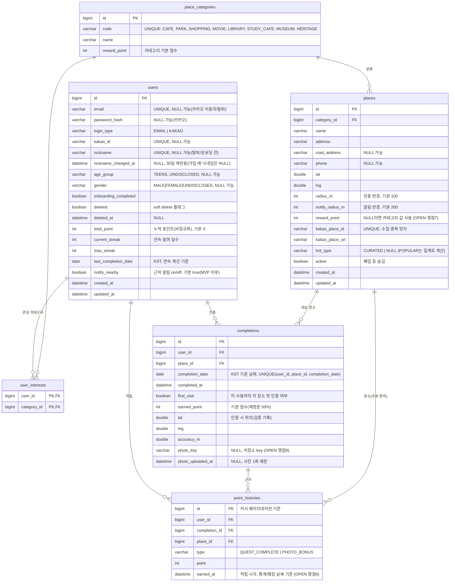

# BbolBbol ERD 초안 (stage 0-3, DRAFT)

> 초안이다. 엔티티와 마이그레이션은 아직 만들지 않는다. **OPEN**은 검토 문서의 미결정 쟁점(2~8)이라 팀 결정 전에는 확정하지 않는다.
> 근거: Notion API 명세서(회원, 지도, 퀘스트 인증, 보상), Gray Area 결정 사항, 검토 문서.
> 공통: 시간대 Asia/Seoul(DB `+09:00`), 한 주는 월요일 시작, 문자셋 utf8mb4.

## 테이블 소유 도메인

| 테이블 | 소유 도메인 | 비고 |
| --- | --- | --- |
| users | user | 다른 도메인은 UserService 메서드로만 접근 |
| user_interests | user | 온보딩 관심 카테고리(최대 3개). 소유 테이블로 user에 포함 |
| places | place | |
| place_categories | place | |
| completions | completion | |
| point_histories | point | 누적 포인트 합계의 원천 |

## ERD (Mermaid)

## 테이블별 메모

### users (user 도메인)
- `nickname`은 UNIQUE이지만 **NULL 허용**. 탈퇴 시 닉네임을 NULL로 비우고 응답에서 "탈퇴한 사용자"로 치환한다. 이렇게 하면 UNIQUE 충돌이 없다(MySQL UNIQUE는 NULL 중복 허용). 카카오 가입자의 온보딩 전 닉네임도 NULL. **OPEN 쟁점4**(제안: NULL + 응답 치환), **OPEN 쟁점5**(온보딩 미완료자의 API 범위와 랭킹 노출).
- 탈퇴(soft delete): `deleted=true`, `deleted_at` 기록, email/nickname/kakao_id/password_hash 제거. 같은 이메일로 즉시 재가입이 가능해야 하므로 email을 비우거나 UNIQUE에서 제외한다. 인증 기록과 포인트는 남기고 랭킹에서 제외한다. 
- 이메일 UNIQUE는 NULL 허용(카카오 이메일 미동의). 같은 이메일의 카카오/이메일 계정은 가입을 막는다(USER4093).
- 연령대와 성별은 추천에만 쓰고 다른 API 응답에 노출하지 않는다.
- 연속 참여 일수(`current_streak`, `max_streak`, `last_completion_date`)와 `total_point`는 users 소유이며, completion/point 쪽은 **UserService 메서드**(예: 포인트 가산, 연속일수 갱신)로만 바꾼다. 완료 기록, 포인트 내역, 누적 포인트, 연속일수는 한 트랜잭션.
- 닉네임 변경 30일 제한: `nickname_changed_at`. 온보딩/가입 때 정한 닉네임은 포함하지 않는다.
- 비밀번호 해시는 로그인 방식이 KAKAO이면 NULL.

### place_categories, places (place 도메인)
- 카테고리 기본 점수는 `place_categories.reward_point`. 장소 `places.reward_point`가 NULL이 아니면 **장소 값이 카테고리 값을 덮는다**(예: 특별 카페 150점). **OPEN 쟁점7**(우선순위 명시, 지역 축제 문구 제거는 명세 수정 사항).
- 장소별 반경: `radius_m`(인증, 기본 100), `notify_radius_m`(알림, 기본 200). 궁궐/큰 공원은 300/400.
- 거리는 Haversine으로 계산한다. 조회용 인덱스 `(lat, lng)` 또는 범위 검색용 인덱스는 구현 단계에서 결정.
- `hot_type`: CURATED(팀이 고른 약 15곳)는 저장. POPULAR(최근 7일 인증 수 상위 20곳, 최소 2회)는 completions 집계로 계산하므로 컬럼으로 저장하지 않는다(캐시 여부는 이후 결정). 둘 다이면 POPULAR 우선.
- 장소 데이터는 카카오 로컬 API로 종로구만 한 번 수집한다. 별점/리뷰는 저장하지 않는다.

### completions (completion 도메인)
- **UNIQUE (user_id, place_id, completion_date)**: 하루 1회, 연타 방지. 위반 예외는 500이 아니라 `COMPLETION409`로 매핑한다. `completion_date`는 KST 0시 기준 날짜.
- 첫 방문 여부 = 이 사용자의 이 장소에 완료 기록이 있는지. 첫 방문 100%, 재방문 50%.
- 사진 보너스: 첫 방문에만, 완료 후 1시간 안에 1회. `photo_uploaded_at` 또는 `photo_key` 유무로 중복 판단(`COMPLETION4091`). 동시 업로드 경합은 completion 행 락 또는 조건부 갱신 필요. 재방문 completion의 사진 허용/제한(보너스 0점)은 명세 보완 필요.
- 사진 저장 key를 `completions/3001.jpg`처럼 ID 기반으로 하면 URL 추측이 가능하고 EXIF GPS 제거도 명세에 없다. **OPEN 쟁점8**(제안: 랜덤 key 또는 서명 URL, 업로드 시 EXIF 제거). 저장은 `PhotoStorage` 포트 사용.
- 탈퇴 사용자의 completion은 장소 통계용으로 남긴다.

### point_histories (point 도메인)
- 포인트는 **적립된 시각에 속한다**: `earned_at` 기준으로 하루/주(월요일 시작) 집계. 23:30 인증 후 00:10에 받은 사진 보너스는 다음 날로 센다. 통계/랭킹은 `earned_at`, 활동 일지는 완료 시각(`completions.completed_at`)으로 통일하자는 제안이 있다. **OPEN 쟁점6**.
- `type`: `QUEST_COMPLETE`, `PHOTO_BONUS`. 한 completion당 QUEST_COMPLETE 1건, PHOTO_BONUS 최대 1건.
- 인덱스: `(user_id, id)`(커서 조회 `id < :cursor ORDER BY id DESC`), `(earned_at, user_id)`(기간 집계/랭킹).
- 포인트는 쌓기만 한다(사용처 없음). 마이너스 내역 없음.
- 응답의 placeName/category는 place를 조인하되, 다른 도메인 repository 직접 접근 대신 서비스 메서드/조회 모델로 해결한다(구현 단계 결정).

## Redis 키 (TTL)

| 키 | 값 | TTL | 설명 |
| --- | --- | --- | --- |
| `refresh:{userId}` | refresh token(또는 해시) | 14일 | 사용자당 1개. 재발급마다 교체, 새 기기 로그인 시 이전 기기 로그아웃. 동시 재발급 경합 대책은 **OPEN 쟁점3**(클라이언트 직렬화 또는 직전 토큰 10~30초 유예) |
| `email-verify:code:{purpose}:{email}` | 6자리 코드 + 남은 시도 횟수 | 10분 | purpose = `SIGNUP` / `RESET`. 5번 틀리면 무효 |
| `email-verify:token:{token}` | `{purpose, email}` | (미정) | 코드 확인 후 발급하는 verificationToken. 추측 불가능한 랜덤 값(UUID 등)으로 Redis에서 조회. **OPEN 쟁점2**. TTL은 명세에 없어 정해야 함 |
| `email-verify:resend:{email}` | 마지막 발송 표시 | 1분 | 재발송 1분 1회 제한 |
| `email-verify:daily:{email}:{yyyyMMdd}` | 발송 횟수 | 다음 KST 0시까지(최대 하루) | 하루 5회 제한 |

키 형식은 초안이며 `{...}` 부분과 purpose 분리 방식은 구현 단계에서 확정한다. 나중에 랭킹 캐시에도 Redis를 쓴다(Gray Area D5).

## 미결정(OPEN) 요약

| 쟁점 | 내용 | 이 초안의 처리 |
| --- | --- | --- |
| 2 | verificationToken 생성 방식 | 랜덤 값 + Redis 저장을 가정. TTL 미정 |
| 3 | refresh rotation 경합 | 키 구조만 정의. 유예 방식 미정 |
| 4 | 탈퇴 닉네임 충돌 | nickname NULL 허용 + 응답 치환을 가정 |
| 5 | 닉네임 null 사용자 | nickname NULL 허용. 막는 범위는 미정 |
| 6 | 통계/랭킹 날짜 기준 | `earned_at` 컬럼 보유. 활동 일지 기준은 미정 |
| 7 | 점수 출처 이중 | 장소 값(NULL 가능)이 카테고리 값을 덮는다고 가정 |
| 8 | 사진 개인정보 | `photo_key` 보유. key 규칙/EXIF 처리 미정 |

그 외 확인이 필요한 항목: 로그인 시도 횟수 제한, 온보딩 관심 카테고리의 별도 테이블(`user_interests`) 사용 여부, 탈퇴 시 email UNIQUE 처리 방식, 장소 상세/조회용 인덱스.

마이그레이션 번호 구역과 작성 규칙: [backend/src/main/resources/db/migration/README.md](../backend/src/main/resources/db/migration/README.md)
